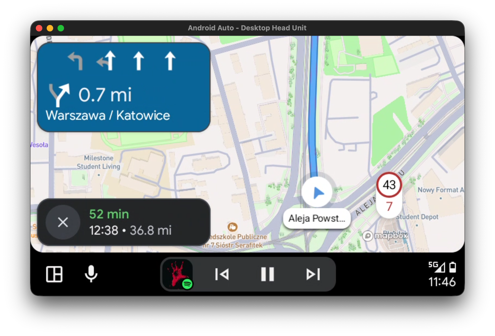

# Mapbox Navigation Android-Auto SDK Examples

The android-auto-app showcases the minimum integration needed to support the android-auto module in your application, it's a portable example that can be copied into your app. See instructions for integrating below.

Route requests from both the phone and Android Auto request alternative routes when available.
During active guidance, the phone displays upcoming maneuver instructions at the top of the map.

<div align="center" padding="100">
  
</div>

## Installation

1. Change "Configuration" of "android-auto-app". "Launch Options - Launch" should be "Nothing"
1. Update or create the "mapbox_access_token.xml" under "android-auto-app/src/main/res/values" and put below
   <?xml version="1.0" encoding="utf-8"?>
       <resources xmlns:tools="http://schemas.android.com/tools">
       <string name="mapbox_access_token" translatable="false" tools:ignore="UnusedResources">PUBLIC TOKEN HERE</string>
   </resources>
1. Establish Android Auto environment by following [Google's document](https://developer.android.com/training/cars/testing) or [Readme](https://github.com/mapbox/mapbox-navigation-android-examples/blob/main/android-auto/README.md)
1. Run "android-auto-app" which installs the app on your device
1. Run the app on "Desktop Head Unit"

## Route Simulation

By default, the example uses route simulation to replay movement along the selected route, so you can test navigation without physically driving.

To use the device's real GPS location instead, set `USE_SIMULATED_ROUTE_REPLAY` to `false` in the companion object of [`MainActivity.kt`](src/main/java/com/mapbox/navigation/examples/androidauto/app/MainActivity.kt):

```kotlin
const val USE_SIMULATED_ROUTE_REPLAY = false
```

Rebuild and run the app to apply the change. This setting applies to both the phone and Android Auto. Location permission is required in either mode.
