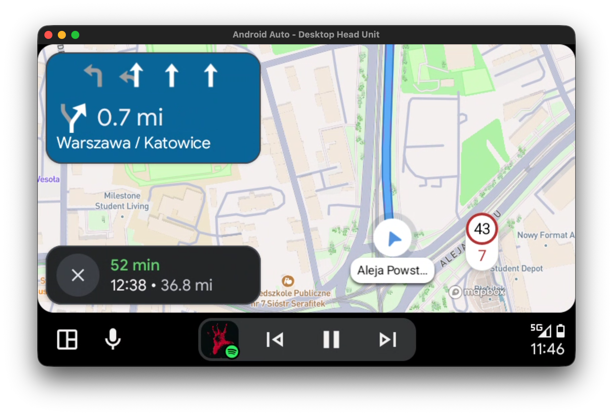

# Mapbox Navigation Android-Auto SDK Examples

The android-auto-app showcases the minimum integration needed to support the android-auto module in your application, it's a portable example that can be copied into your app. See instructions for integrating below.

Route requests from both the phone and Android Auto request alternative routes when available.
During active guidance, the phone displays upcoming maneuver instructions at the top of the map.

Free drive does not start automatically when the app opens, location permission is granted, or
Android Auto connects. Tap **Start free drive** on the phone or Android Auto to start the shared trip session
before requesting a route. Starting a trip session begins billing, including in free drive.
With location permission granted, the phone still shows and centers on your device's current
location before you tap the button; this uses the map's location provider, not a trip session.

Android Auto shows a start screen explaining why location and navigation are paused and that
starting a session begins billing. After tapping **Start free drive**, wait for a location fix
before using search, favorites, or voice navigation. If a "Navigate to..." request arrives before
the session starts, the app shows the start screen and asks you to repeat the request afterward.
Location permission still needs to be granted on the phone.

## Navigation settings

This example uses Navigation SDK `3.35.0-rc.1` for inline settings. On Car App API 7 or newer,
the settings action opens **Navigation settings** alongside the map in free drive, route preview,
and active guidance. Back closes the panel without clearing the route preview or stopping guidance.
Settings also close when the navigation mode changes or another screen covers navigation.

`MainCarSession` registers a `CarSettingsTemplateProvider` that shares the voice-guidance toggle
with `CarSettingsScreen`, the fallback for older hosts. Changes apply immediately and use the same
stored mute state as the navigation audio control. `CarMapCustomization` retains the SDK's default
unified actions and adds settings to legacy preview and guidance strips without removing feedback,
audio guidance, or Stop.

<div align="center" padding="100">
  
</div>

## Installation

1. Change "Configuration" of "android-auto-app". "Launch Options - Launch" should be "Nothing"
1. Update or create the "mapbox_access_token.xml" under "android-auto-app/src/main/res/values" and put below
   <?xml version="1.0" encoding="utf-8"?>
       <resources xmlns:tools="http://schemas.android.com/tools">
       <string name="mapbox_access_token" translatable="false" tools:ignore="UnusedResources">PUBLIC TOKEN HERE</string>
   </resources>
1. Establish Android Auto environment by following [Google's document](https://developer.android.com/training/cars/testing) or [Readme](https://github.com/mapbox/mapbox-navigation-android-examples/blob/main/android-auto/README.md)
1. Run "android-auto-app" which installs the app on your device
1. Run the app on "Desktop Head Unit"

## Route Simulation

By default, the example uses route simulation to replay movement along the selected route, so you can test navigation without physically driving.

To use the device's real GPS location instead, set `USE_SIMULATED_ROUTE_REPLAY` to `false` in the companion object of [`MainActivity.kt`](src/main/java/com/mapbox/navigation/examples/androidauto/app/MainActivity.kt):

```kotlin
const val USE_SIMULATED_ROUTE_REPLAY = false
```

Rebuild and run the app to apply the change. This setting applies to both the phone and Android Auto. Location permission is required in either mode.
